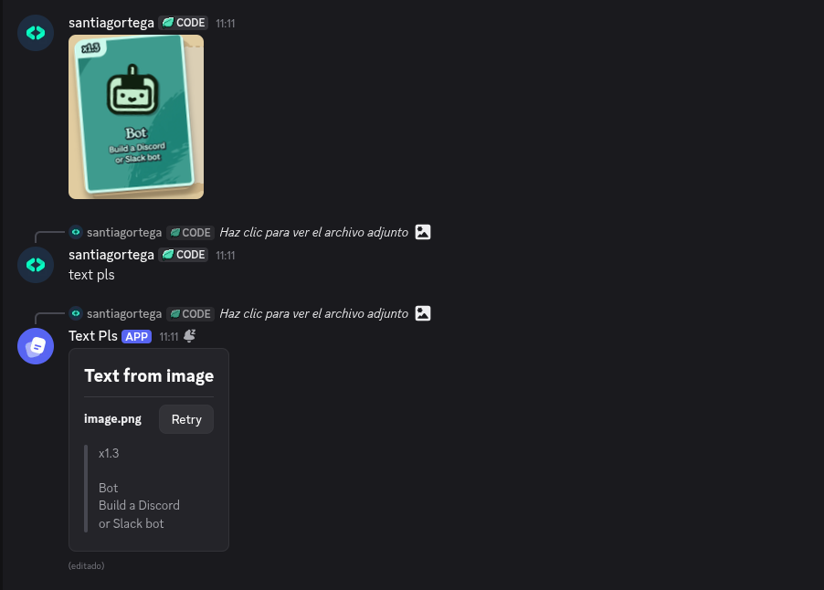

# Text pls
just a discord bot to get the text from a image, pdf, audio, etc

## Support files

- .png
- .jpg
- .jpeg
- .webp
- .bmp
- .ogg
- .mp3
- .wav
- .m4a
- .opus
- .flac
- .pdf

> [!NOTE]
> Audio limit: 19.5MB max
> 
> Img limit: discord's file limit
> 
> Pdf limit: 20 max (you can change it in the script but i can be slow)

## Quick start
1. Add the bot to a server (click the image or the link)

   
   
   https://discord.com/oauth2/authorize?client_id=1557916758948585552

2. Send a photo or audio or document

3. Reply that message with "text pls"

4. Wait for the response

that's it! simple to use

## IA?
yes, for some funtions like the pdf i paste code from claude and not for the design, the command, the apis, etc
