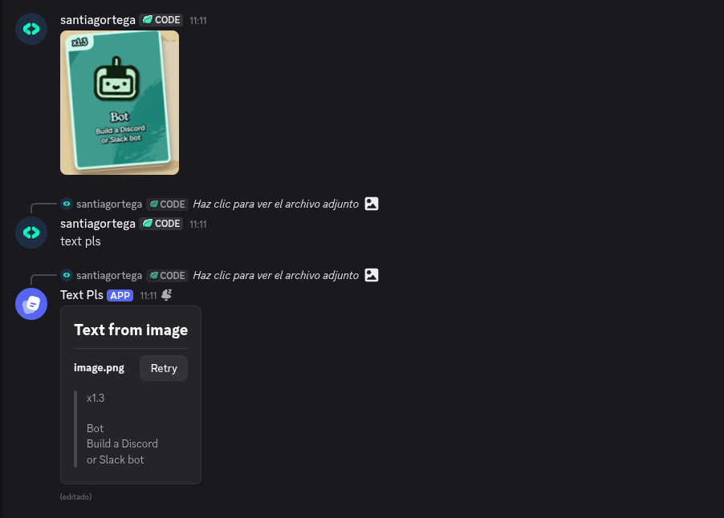

# Text pls
just a discord bot to get the text from a image, pdf, audio, etc



## Support files

- .png
- .jpg
- .jpeg
- .webp
- .bmp
- .ogg
- .mp3
- .wav
- .m4a
- .opus
- .flac
- .pdf


> [!NOTE]
> Audio limit: 19.5MB max
> 
> Img limit: discord's file limit
> 
> Pdf limit: 20 pages max (you can change it in the script but i can be slow)

## Quick start
1. Add the bot to a server (click the image or the link)

   [](https://discord.com/oauth2/authorize?client_id=1557916758948585552)
   
   https://discord.com/oauth2/authorize?client_id=1557916758948585552

2. Send a photo or audio or document

3. Reply that message with "text pls"

4. Wait for the response

that's it! simple to use

## Host it your self!
1. **Clone the repo**
```bash
git clone https://github.com/SantiagortegaDev/text-pls.git
cd text-pls
```
2. **Create a virtual enviroment in python**<br>(optional, only if you want)
```bash
python3 -m venv venv
source venv/bin/activate
```
3. **Create .env file**
```bash
cp .env.example .env
nano .env
```
4. **Install dependencies**
```bash
pip install -r requirements.txt
```
5. **Run the best bot of discord**<br>(just kidding)
```bash
python3 bot.py
```

## IA?
yes, for some funtions like the pdf i paste code from claude and not for the design, the command, the apis, etc
